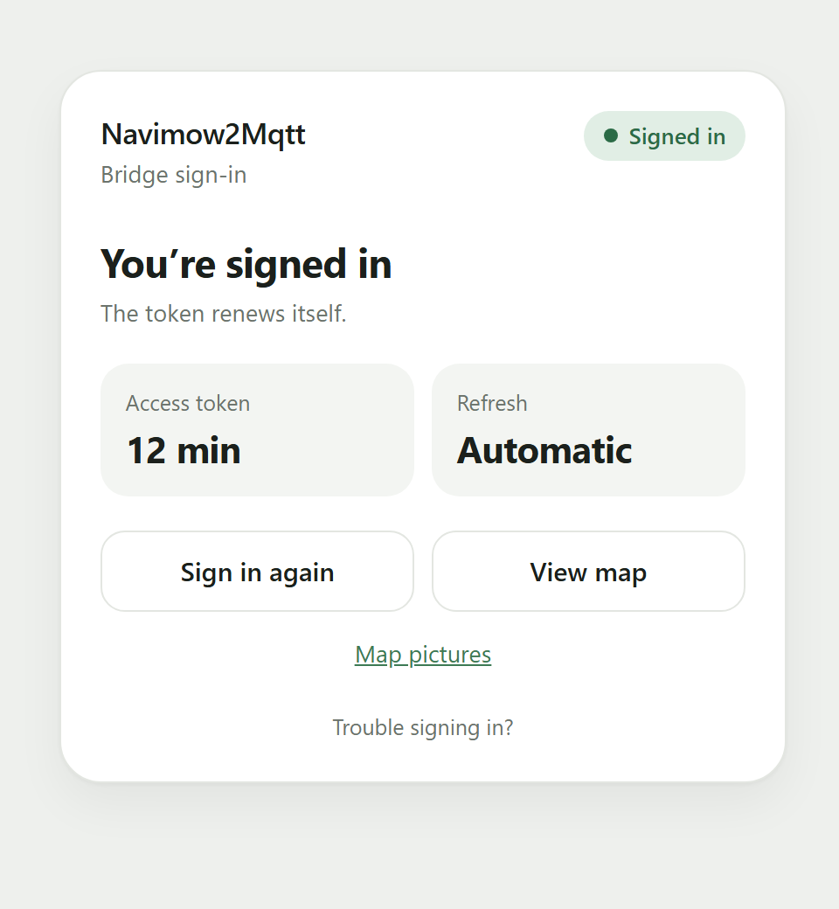
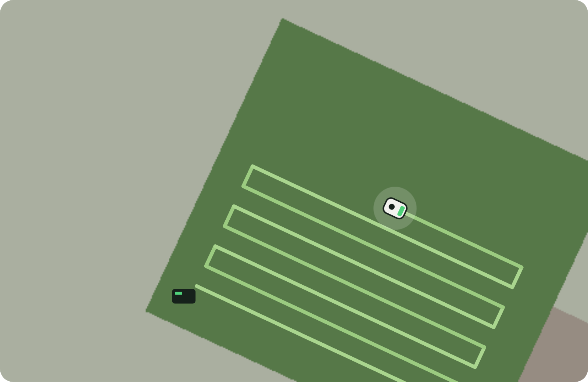
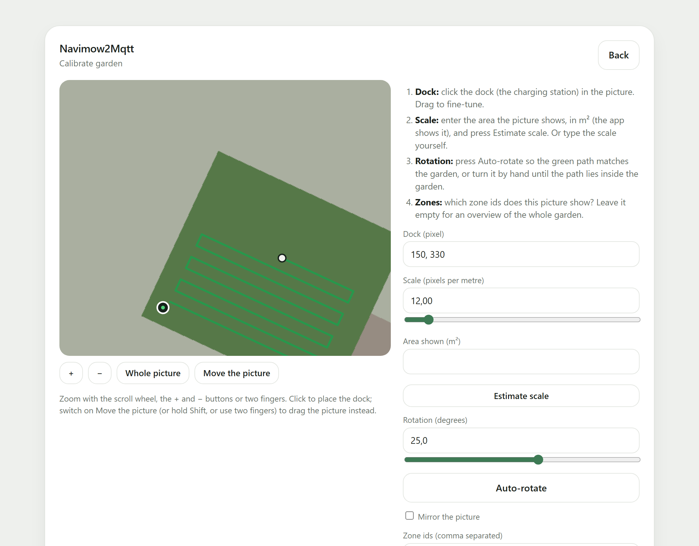
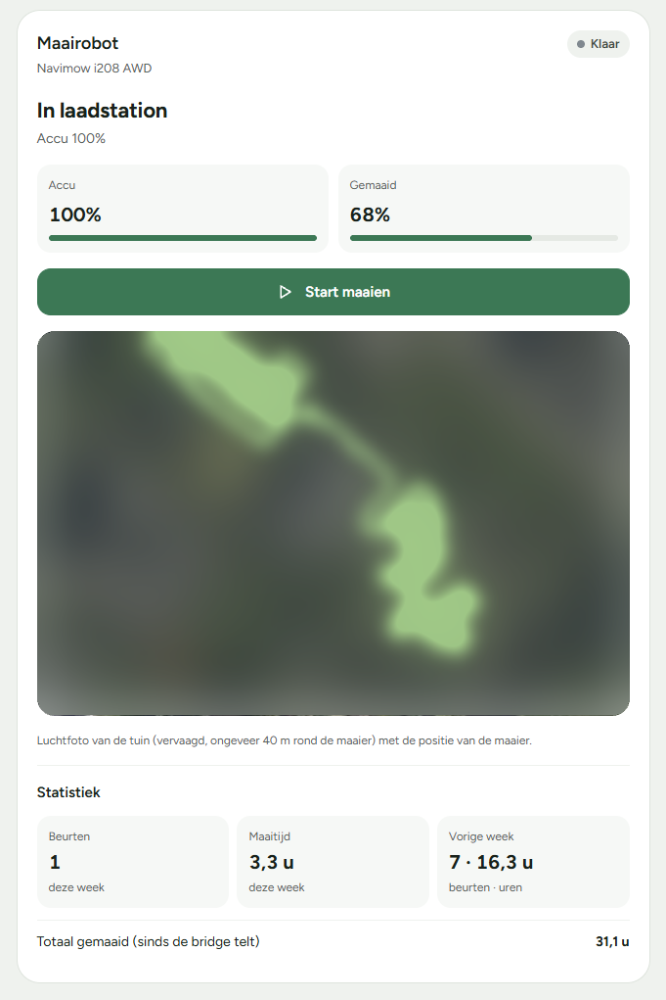

# navimow2mqtt

*[Nederlandse versie: README.nl.md](README.nl.md)*

Connect Segway **Navimow** robotic mowers to **MQTT**, with automatic **Home Assistant** discovery (lawn mower entity with
start / pause / dock, battery, status). Runs as a **Docker** container. It also publishes the mower's position and mowed
path, weekly statistics, and renders a small map tile that you can drop into a dashboard (openHAB, Home Assistant, ...).

It uses the same cloud API as the official integration
[segwaynavimow/NavimowHA](https://github.com/segwaynavimow/NavimowHA) (and its
[navimow-sdk](https://github.com/segwaynavimow/navimow-sdk)), but without a Home Assistant custom component:
everything goes through your own MQTT broker.

> This project is not affiliated with Segway/Ninebot/Willand. The API is not publicly documented and may change.



Developed and tested against a **Navimow i208 AWD** (LiDAR model, Europe region).

## How it works

```
 Navimow cloud ── REST (status, commands) ──┐
      │                                      ├─ navimow2mqtt (Docker) ── MQTT ── Home Assistant / openHAB / ...
      └── MQTT over WSS (live state pushes) ─┘
```

1. You sign in **once** with your Navimow account (OAuth2); the token is kept in `/data/token.json` and refreshes itself.
2. The bridge listens on the cloud MQTT for live status (state, events, attributes, location) and falls back to HTTP
   polling when nothing arrives for 90 s.
3. Commands (start / pause / resume / dock) go through the REST API.
4. Everything is published as JSON on your own broker, with Home Assistant discovery.

## Install

```bash
cp .env.example .env      # set MQTT_HOST etc.
docker compose up -d --build
```

Then open **`http://<your-server>:8099`** in a browser and sign in (see below). The token is stored in the
`navimow-data` volume, so you do not have to sign in again after a restart or rebuild.

Running it on a server with **Portainer**? See [docs/PORTAINER.md](docs/PORTAINER.md) (build and import the image,
stack from `docker-compose.portainer.yml`, one-time sign-in).

### Signing in

You never have to dig through the container or its logs. Pick one of three ways:

**1. The sign-in page (recommended)** at `http://<your-server>:8099`
   The page is in English by default; `LANGUAGE=nl` switches it (and the messages and map texts) to Dutch.
   It shows a small card: whether you are signed in, how long the access token is still valid, whether it refreshes
   automatically, and two buttons: *Sign in to Navimow* (or *Sign in again*) and *View map*.
   - **Automatic:** click *Sign in to Navimow*, sign in with your Navimow account and you are sent back to the bridge.
     This works because Navimow accepts a return address on your own server (the page uses the address you opened it on).
     There is nothing to paste.
   - **Paste** (only if the automatic return stops working, for example because Navimow changes its login; it is hidden
     on purpose under the small grey *Trouble signing in?* line): expand it and sign in via *Open the Navimow sign-in*.
     You land on a page of `my.home-assistant.io`; you do not need Home Assistant. Copy the **full address from the
     address bar** (it contains `code`) and paste it on the sign-in page.

   The page has no password and never shows tokens; only open the port on your own network (`WEB_PORT=0` turns the page off).

**2. Via MQTT.** When signing in again is needed, the link is published (retained) on `navimow/bridge/login_url` and
   `navimow/bridge/auth` becomes `required`. Publish the address from the address bar (or just the code) to
   `navimow/bridge/login`; the result appears on `navimow/bridge/login_result`. This works once the bridge has been
   started with a token; the very first sign-in goes through the page.

**For openHAB, Node-RED and the like:** set `PUBLIC_URL` in `.env` to the address where you reach the page, for example
`PUBLIC_URL=http://192.168.1.5:8099`. The container cannot know that address itself (it only sees an internal Docker
IP). It is published retained on `navimow/bridge/web_url`, even before the first sign-in.

**3. In a terminal:**
   ```bash
   docker compose run --rm navimow2mqtt python -m navimow2mqtt login
   ```

> The access token is valid for about **1 hour** according to measurements by other integrations (the official
> integration says 1 to 2 days), so the bridge refreshes it often. Whether the server issues a `refresh_token` and keeps
> accepting it differs per user report ([NavimowHA#86](https://github.com/segwaynavimow/NavimowHA/issues/86)). On the
> author's account (i208 AWD) automatic refresh works. If a refresh is ever refused, `navimow/bridge/auth` becomes
> `required` and in Home Assistant the **Login required** binary sensor turns on; sign in again.

### Reliability of the live updates

The cloud MQTT can drop silently (half-open connection) while the client still reports "connected". Therefore:

- keepalive of 120 s, so a dead connection is noticed within minutes;
- on every reconnect the MQTT credentials are fetched again (they are tied to the OAuth token), with at least 65 s
  between requests, because the server refuses requests that come too often;
- a **watchdog**: if the HTTP status differs from the last MQTT push, the MQTT connection is rebuilt (at most once per
  5 minutes).

This approach is taken from [NaviWatch](https://github.com/MadMorpheus/naviwatch). If the mower is shared with a second
Navimow account, your phone app does not get signed out.

## Configuration

Everything through environment variables (`.env`):

| Variable | Meaning | Default |
|---|---|---|
| `MQTT_HOST`, `MQTT_PORT` | your broker | `localhost`, `1883` |
| `MQTT_USERNAME`, `MQTT_PASSWORD` | credentials | – |
| `MQTT_BASE_TOPIC` | topic prefix | `navimow` |
| `MQTT_DISCOVERY`, `MQTT_DISCOVERY_PREFIX` | Home Assistant discovery | `true`, `homeassistant` |
| `MQTT_CLIENT_ID` | client id | `navimow2mqtt` |
| `HTTP_POLL_INTERVAL` | minimum pause between fallback polls (s) | `60` |
| `MQTT_STALE_SECONDS` | no cloud push for this long → HTTP fallback (s) | `90` |
| `OFFLINE_AFTER` | no data for this long → mower `offline` (s) | `300` |
| `LOG_LEVEL` | `INFO` or `DEBUG` | `INFO` |
| `LOG_DIR`, `LOG_KEEP_DAYS`, `LOG_MAX_MB` | log files, retention, maximum per day | `/data/logs`, `14`, `50` |
| `WEB_PORT` | port of the sign-in page, `0` = off | `8099` |
| `LANGUAGE` | language of the pages and map texts: `en` or `nl` | `en` |
| `MAPS_DIR`, `TRAIL_FILE` | folder with the background pictures (empty = off) and file for the last path (empty = memory only) | `/data/maps`, `/data/trail.json` (in the image) |
| `TIMEZONE` | time zone for the start of a week, e.g. `Europe/Amsterdam` | `UTC` |
| `STATS_FILE`, `STATS_WEEKS`, `STATS_MIN_SESSION_S` | weekly statistics: file (empty = off), weeks kept, minimum mowing time of a session in seconds | `/data/stats.json` (in the image), `12`, `60` |
| `PATH_MAX_POINTS` | number of points kept of a mowing session's path (enough for a whole zone), `0` = off | `8000` |
| `PUBLIC_URL` | address of the sign-in page from your network, published on `bridge/web_url` | – |
| `NAVIMOW_TOKEN_FILE` | token file | `/data/token.json` |
| `NAVIMOW_REDIRECT_URI` | redirect after sign-in | `https://my.home-assistant.io/redirect/oauth` |
| `NAVIMOW_API_URL`, `NAVIMOW_AUTHORIZE_URL`, `NAVIMOW_TOKEN_URL`, `NAVIMOW_CLIENT_ID`, `NAVIMOW_CLIENT_SECRET` | endpoints and OAuth client | as the official integration |

The client id and client secret are those of the official Home Assistant integration (public in its repository).
The region is currently `fra` (Europe).

## MQTT

> The **complete** list of topics, payloads, retained behaviour and discovery is in [docs/MQTT.md](docs/MQTT.md).
> The table below is a summary.

| Topic | Content |
|---|---|
| `navimow/<name>/state` | JSON: `state`, `activity`, `battery`, `signal_strength`, `position`, `error`, `last_update` (retained) |
| `navimow/<name>/availability` | `online` / `offline` |
| `navimow/<name>/info` | JSON with id, name, model, firmware, serial number |
| `navimow/<name>/event` | events from the mower and failed commands |
| `navimow/<name>/location` | raw JSON array of the undocumented `location` channel (retained; empty while docked) |
| `navimow/<name>/position` | unpacked: `x`, `y` (m from the dock), `distance_m`, `heading_deg`, `course_deg` (the direction it actually moved), `vehicle_state`, `zone`, `progress_pct`, `target_zone`, `task_delay`, `last_update` (retained; only fields that were ever received) |
| `navimow/<name>/path` | the path of the current mowing session: `points` (list of `[x, y]`, m from the dock), `count`, `started`, `last_update` (retained) |
| `navimow/<name>/stats`, `…/session` | weekly statistics and one message per finished session |
| `navimow/<name>/command` | **write here**: `start`, `pause`, `resume`, `dock`, `stop` |
| `navimow/bridge/status` | `online` / `offline` (Last Will) |
| `navimow/bridge/auth` | `ok` / `required` |
| `navimow/bridge/login_url` | link to sign in, only filled when `auth` = `required` (retained) |
| `navimow/bridge/web_url` | address of the sign-in page, from `PUBLIC_URL` (retained, only when set) |
| `navimow/bridge/login` | **write here** the address from the address bar (or the code) to sign in |
| `navimow/bridge/login_result` | outcome of that attempt |

`<name>` is the mower's name from the app, converted to `a-z0-9_`. A `start` while the mower is paused automatically
becomes a `resume`.

States: `idle`, `docked`, `charging`, `mowing`, `paused`, `returning`, `error`, `unknown`. The `activity` is the Home
Assistant variant (`docked`, `mowing`, `paused`, `returning`, `error`).

### Location (experimental)

The `location` channel is not in the official SDK; it was found by [NaviWatch](https://github.com/MadMorpheus/naviwatch).
The messages are a JSON array with items per `type`: 1 = position (`postureX`/`postureY` in metres relative to the
charging station, **not GPS**, plus `postureTheta`), 2 = zone and progress (`currentMowBoundary`, `currentMowProgress`
0–10000), 3 = commanded zone, 4 = delay. Probably only **LiDAR models** send this; without LiDAR (e.g. i105) it stays
silent. Tested on an **i208 AWD**: while driving, a type-1 message arrives every few seconds; in the dock the array is empty.

`x`/`y` are a local grid around the dock (the dock is roughly at (0, 0)), rounded to 0.25 m, one update every 8 to 20 s.
`heading_deg` is `postureTheta` in degrees (0–360), counter-clockwise from the +x axis; it is not fully reliable
(sometimes about 180° off, possibly a reading while turning). `course_deg` is the direction of the last movement
(between the last two different positions) and is more reliable in a garden with many turns. `progress_pct` is
`currentMowProgress / 100`. For Home Assistant the matching sensors are disabled by default.

**Path.** On `navimow/<name>/path` the bridge keeps the points of the running session, usable for a line on a dashboard.
A point is added while the mower is driving (`mowing`, `paused` or `returning`) and the position changed. When the status
goes from `docked`, `idle` or `charging` to `mowing`, the path starts over; pausing and resuming does not clear it. At most
`PATH_MAX_POINTS` points are kept (default 8000). The retained MQTT message holds a thinned copy of at most 500 points
(`count`) with the real number in `total`; the map tile uses all points. The path is stored in `/data/trail.json`, so a
restart does not lose it.

**Recovering the path of an earlier session.** Every position message is in the log file. If a path was cut off, or the
bridge was not running at the start of the session, load it from the log: open `http://<server>:8099/maps`, pick a picture
and click *Load the full path of the last mowing session from the log*, or run (with the bridge stopped):

```bash
docker compose stop
docker compose run --rm --no-deps navimow2mqtt python -m navimow2mqtt rebuild-trail
docker compose start
```

Without options it takes the last session; `--name`, `--since` and `--until` (ISO times) pick another one.

## Weekly statistics

The bridge counts, per week, the number of mowing sessions and the mowing time (time in the `mowing` state) and publishes
that on `navimow/<name>/stats`; every finished session is also published separately on `navimow/<name>/session`, so
openHAB (or anything else) can keep its own long history. At most 12 weeks are kept in `/data/stats.json` (a few
kilobytes, no database). Set `TIMEZONE`: a week starts on Monday 00:00 in that time zone. Area (m²), blade wear and the
lifetime counter are not provided by the official API.

## Log files

The bridge writes two kinds of logs to `/data/logs` (the `navimow-data` volume):

| File | Content |
|---|---|
| `events-<date>.jsonl` | one JSON line per event, per UTC day; meant for analysis |
| `navimow2mqtt.log` | the normal readable log, rotating (5 × 2 MB) |

Tokens, passwords, Navimow MQTT credentials, sign-in links and codes are **never** written. The raw mower messages do
contain the mower's serial number and position data, so share the files deliberately. Settings: `LOG_DIR` (empty = no
files), `LOG_KEEP_DAYS` (14) and `LOG_MAX_MB` (50 per day). To fetch the files from the server:

```bash
docker compose cp navimow2mqtt:/data/logs ./logs-export
```

## Map

At `http://<server>:8099/tile.svg` (and as a page at `/tile`; `/map.svg` and `/map` are the same) the bridge draws a small
map tile: a dark green lawn on which the mowed path appears as light green stripes in two alternating shades, the
charging station, and the mower as a little robot with a pulsing ring. It is only the rounded tile: no card, no title, no
text, and the corners are transparent, so it takes over the background of your dashboard.



Parameters: `w`, `theme`, `swath`, `device`, `view`, `span`, `idle_span`, `follow` (see [docs/OPENHAB.md](docs/OPENHAB.md)).

**Background pictures.** At `http://<server>:8099/maps` you upload a screenshot of the Navimow app, click the dock, enter
the area in m² (for the scale) and let the mowed path rotate automatically until it lies inside the garden. After that
`/tile.svg?view=NAME` shows the tile on the real shape of your garden, and `&span=12` zooms to 12 metres around the mower.
With `&idle_span=0` added you see the whole picture at rest and the tile only zooms in while the mower is driving
(`/tile.svg?view=garden&span=12&idle_span=0`). With `view=auto` the bridge picks the picture of the zone the mower is in.
The garden itself is not provided by the official API, hence the one-time calibration. The pictures are in `/data/maps`,
the last path in `/data/trail.json` (both in the volume). The calibration page can be zoomed (scroll wheel, +/− buttons or
two fingers) to place the dock precisely.



*(The pictures above use a made-up garden.)*

## openHAB

[docs/OPENHAB.md](docs/OPENHAB.md) lists per function what the bridge offers and on which MQTT addresses
(status, control, position, path, sign-in monitoring) and how the map works as a URL. A card built with the openHAB
Main UI looks like this (aerial photo and path blurred on purpose):




## Your own dashboard and backend

If you want to build a web dashboard with history and path display yourself, a worked-out brief is in
[docs/INSTRUCTIONS.md](docs/INSTRUCTIONS.md). For openHAB you do not need it.

## Home Assistant

With discovery, each mower shows up as a device with: **lawn_mower** (start, pause, dock), **Battery**, **State** and
**Signal strength** (disabled by default). The device **Navimow2Mqtt** has the binary sensor **Login required**; build an
automation on it if you want a notification.

## Troubleshooting

| Problem | Cause |
|---|---|
| `login required` in the log | token expired or no `login` done yet |
| Sign-in fails (`token endpoint refused`) | the code was already used or has expired (it is only valid briefly): start again with a new link. With option 1, check that you opened the page on the address where your server is reachable |
| No live updates, only polling | cloud MQTT refused; set `LOG_LEVEL=DEBUG` and look for `cloud MQTT` |
| Mower not found | a region other than Europe, or an account without a shared mower |

## Development

```bash
python -m venv .venv && .venv/Scripts/pip install -r requirements.txt
python -m unittest discover -s tests
```

```
navimow2mqtt/
  auth.py      OAuth2: sign-in URL, code exchange, token refresh and storage
  api.py       REST: devices, status, MQTT credentials, commands
  cloud.py     cloud MQTT (WSS), renews the credentials on every reconnect
  models.py    state normalisation, location and path
  ha.py        topics and Home Assistant discovery
  bridge.py    connects the cloud and the local broker
  tileview.py  the map tile (SVG)
  maps.py      background pictures and calibration
  mapsweb.py   the pictures and calibration pages
  web.py       the web server (sign-in, tile, pictures)
  stats.py     weekly statistics
  datalog.py   event log
  config.py    environment variables
```

## Status

Tested against the real Navimow cloud on an **i208 AWD** (sign-in, automatic token refresh, live MQTT updates, location
channel, map tile, statistics). Other models and regions are untested; the fields of the OAuth response and the MQTT
messages are derived from the official SDK and integration. Report what you run into, and set `LOG_LEVEL=DEBUG` for the
raw payloads.

## Credits

[segwaynavimow/NavimowHA](https://github.com/segwaynavimow/NavimowHA) and
[navimow-sdk](https://github.com/segwaynavimow/navimow-sdk) for the API knowledge, and
[NaviWatch](https://github.com/MadMorpheus/naviwatch) for the findings on the freezing MQTT connection. The project is
loosely modelled on gro2mqtt.

## License

[MIT](LICENSE).
